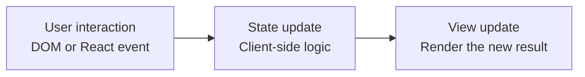

# User management sample react

**Portfolio project** · A simple React user-management demo built with reusable components and local state.

## Overview

A simple React user-management demo built with reusable components and local state.

## Technology Stack

- `Node.js`
- `React`
- `HTML`
- `CSS`
- `JavaScript`

## How the Repository Works

| Stage | Responsibility |
|---|---|
| **User interaction** | DOM or React event |
| **State update** | Client-side logic |
| **View update** | Render the new result |

## Concepts Covered

- Component-based UI
- State and props
- Event handling
- Reusable layout
- Client-side rendering

## Repository Map

- `.gitignore`
- `package-lock.json`
- `package.json`
- `public`
- `src`

## Recruiter Summary

This repository demonstrates practical implementation skills, repository organization, and an end-to-end understanding of the project workflow. It is suitable as a focused example of applied software or data work.

---

Documentation is concise and project-focused; source code was not modified.
